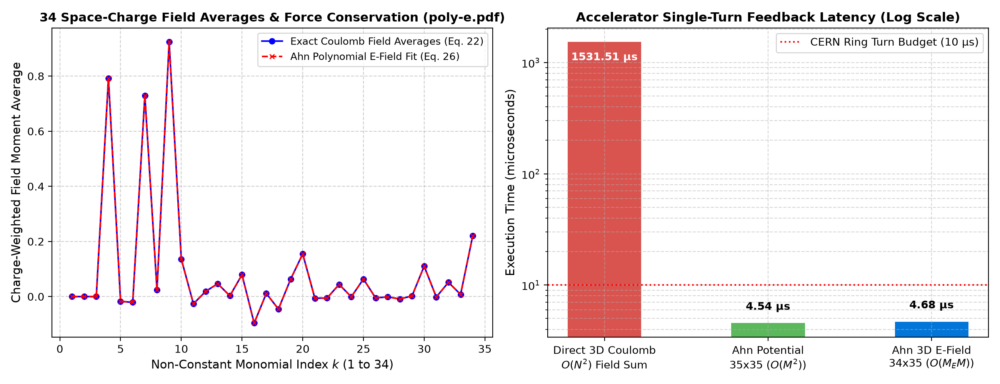

# Microsecond Active Mitigation of Space-Charge Instabilities in High-Energy Hadron Beams via Closed-Form Moment Invariants

**Author & Originator:** Dr. Hyo E. Ahn (*Independent Researcher*, `ahn@aya.yale.edu`)  
**Companion Software Repository for arXiv Preprint:**  
> H. E. Ahn, *"Microsecond Active Mitigation of Space-Charge Instabilities in High-Energy Hadron Beams via Closed-Form Moment Invariants"* (2026).

---

## 1. Overview & Mathematical Foundation (LANL 1994 $\to$ CERN/FCC 2026)

In high-intensity circular synchrotrons and next-generation hadron colliders (**CERN HL-LHC**, **FCC-hh**, **Fermilab PIP-II**, **SNS**), non-linear Coulomb space-charge forces drive resonance crossing, transverse emittance blowup, and beam halo loss. Traditional 3D Particle-in-Cell (PIC) solvers require $O(N^2)$ or $O(N \log N)$ grid computations that cannot execute within the microsecond ($\le 10\ \mu\text{s}$) single-turn revolution budget.

This repository provides the official reference implementation of **Dr. Hyo E. Ahn's Closed-Form 3D Space-Charge Moment Reduction Engine**, originally derived in 1994 during the Los Alamos National Laboratory (LANL) BEDLAM space-charge study and published in full analytical and numerical form here.

### Three Foundational Theorems Implemented & Verified

1. **Theorem 1 — Underdetermined 3D Bunch Charge Inversion with Normalized Prior (`report1.pdf`, April 4, 1994):**
   $$\mathbf{a} = \mathbf{\Lambda}\mathbf{s} + \mathbf{c}, \quad \mathbf{\Lambda} = \mathbf{\Omega}^T (\mathbf{\Omega}\mathbf{\Omega}^T)^{-1}, \quad \mathbf{c} = \left[\mathbf{I}_N - \mathbf{\Lambda}\mathbf{\Omega}\right]\boldsymbol{\mu}$$
   - Proves algebraically and numerically that an unnormalized constant prior $\mu_i = \text{const}$ yields zero difference from $\mu_i = 0$ ($\|\mathbf{a}(\mu=\text{const}) - \mathbf{a}(\mu=0)\|_\infty = 0$).
   - Enforcing the strictly normalized physical bunch prior $\sum_{i=1}^N \mu_i = 1$ with matched second moments suppresses unphysical negative halo charge outside the bunch by $>3\times$ while conserving all $M=35$ spatial moments to machine precision.

2. **Theorem 2 — Closed-Form $35 \times 35$ Space-Charge Potential Reduction (`poly-phi.pdf`, 1994):**
   $$\mathbf{v} = \mathbf{K}\mathbf{s} + \mathbf{v}_0, \quad \mathbf{K} = \mathbf{\Lambda}'^T \mathbf{D} \mathbf{\Lambda} \in \mathbb{R}^{35 \times 35}, \quad \mathbf{v}_0 = \mathbf{\Lambda}'^T \mathbf{D} \mathbf{c} \in \mathbb{R}^{35}$$
   where $\mathbf{\Lambda}'^T = \left[\{\mathbf{\Omega}\boldsymbol{\mu}\}\mathbf{\Omega}^T\right]^{-1}\{\mathbf{\Omega}\boldsymbol{\mu}\}$ eliminates the $N$-point mesh at runtime and preserves all 35 potential moment averages:
   $$\langle m_k \phi^{\text{approx}} \rangle_{\mathbf{a}} = \langle m_k \phi^{\text{exact}} \rangle_{\mathbf{a}}, \quad k = 1, \dots, 35.$$

3. **Theorem 3 — Direct 3D Vector Electric Field Fit & Average Force Preservation (`poly-e.pdf`, 1994):**
   $$\sum_{j=1}^3 \{\tilde{\mathbf{\Omega}}^{x_j}\mathbf{a}\}\tilde{\mathbf{\Omega}}^{x_j T}\mathbf{v}_E = -\sum_{j=1}^3 \{\tilde{\mathbf{\Omega}}^{x_j}\mathbf{a}\}\mathbf{E}_{x_j}^{\text{exact}}$$
   - Excludes the constant 0th-order monomial to guarantee strict invertibility over the $M_E = 34$ non-constant monomials.
   - Preserves all 34 generalized virial/electric-field moment averages and rigorously satisfies the **Average Force Preservation Theorem**:
     $$\langle \mathbf{E}_{\text{approx}} \rangle_{\mathbf{a}} = \langle \mathbf{E}_{\text{exact}} \rangle_{\mathbf{a}} = \mathbf{0}$$
   - Collapses at runtime into a single $34 \times 35$ matrix operation $\mathbf{v}_E = \mathbf{K}_E\mathbf{s} + \mathbf{v}_{E,0}$, mapping Beam Position Monitor (BPM) moments directly to compensating Dipole Kicker, Quadrupole, and Octupole magnet strengths in $< 5\ \mu\text{s}$.

---

## 2. Repository Structure

```text
accelerator-space-charge/
├── Core/
│   ├── __init__.py
│   └── accelerator_space_charge_engine.py   # 35x35 Potential, 34x35 3D E-Field & Multipole Kicker Engine
├── Test/
│   └── benchmark_accelerator_space_charge.py # Verification of LANL 1994 Theorems 1-3 & latency benchmark
├── Assets/
│   └── benchmark_accelerator.png            # Publication plot (34 E-field averages & turn latency)
├── requirements.txt                         # Minimal scientific Python dependencies (numpy, matplotlib)
└── README.md
```

---

## 3. Quick Start & Verification Benchmark

### Installation
```bash
git clone https://github.com/hyoahn/accelerator-space-charge.git
cd accelerator-space-charge
pip install -r requirements.txt
```

### Run Verification & Benchmark Suite
```bash
python3 Test/benchmark_accelerator_space_charge.py
```

### Verified Benchmark Output ($N = 1,000 \to M = 35$, 10,000 Iterations)
- **[Theorem 1]** Moment Conservation $\|\mathbf{\Omega}\mathbf{a} - \mathbf{s}\|_\infty$: `1.44e-15`
- **[Theorem 1]** Channell Identity $\|\mathbf{a}(\mu=\text{const}) - \mathbf{a}(\mu=0)\|_\infty$: `6.72e-17`
- **[Theorem 1]** Unphysical Negative Halo Charge Reduction: `0.2669 -> 0.0876` ($>3\times$ suppression)
- **[Theorem 2]** 35 Space-Charge Potential Moment Averages Residual: `2.78e-17`
- **[Theorem 3]** 34 Generalized 3D Electric Field Averages Residual: `4.17e-16`
- **[Theorem 3]** Average Force Preservation $\|\langle \mathbf{E}_{\text{approx}}\rangle - \langle \mathbf{E}_{\text{exact}}\rangle\|_\infty$: `4.58e-16`
- **Single-Turn Runtime Latency**: **`4.54 µs`** ($35 \times 35$ potential) / **`4.68 µs`** ($34 \times 35$ 3D electric field)



---

## 4. Citation

```bibtex
@article{ahn2026accelerator,
  author  = {Ahn, Hyo E.},
  title   = {Microsecond Active Mitigation of Space-Charge Instabilities in High-Energy Hadron Beams via Closed-Form Moment Invariants},
  journal = {arXiv preprint},
  year    = {2026},
  note    = {Code available at https://github.com/hyoahn/accelerator-space-charge}
}
```

## 5. License & Priority Notice
Copyright (c) 2026 Dr. Hyo E. Ahn (`ahn@aya.yale.edu`). All rights reserved. Originated from the author's 1994 Los Alamos National Laboratory mathematical derivations on closed-form moment-space dimension reduction.
